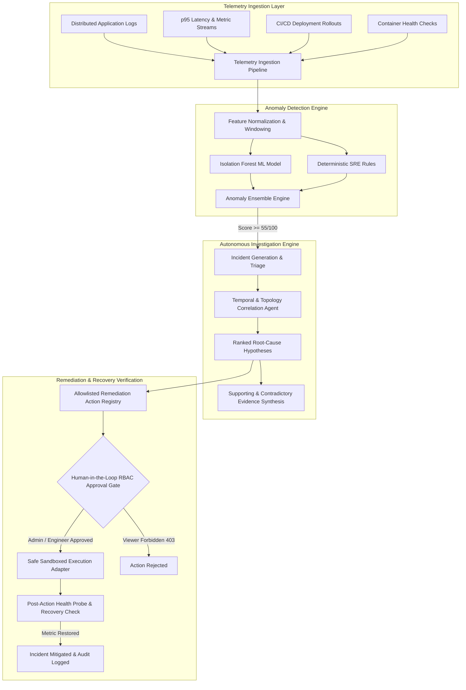

# NIGHTWATCH AI — Autonomous Incident Investigation Platform

> **“Detect faster. Investigate smarter. Recover with confidence.”**

Nightwatch AI is an enterprise-grade incident-investigation and Site Reliability Engineering (SRE) platform. It continuously correlates distributed telemetry (logs, metrics, deployment changes, and service dependency topology), detects anomalies using an Isolation Forest ML pipeline alongside deterministic operational rules, ranks root-cause hypotheses with explicit supporting citations, and safely executes verified remediations with human-in-the-loop authorization gates.

---

## 1. System Architecture



---

## 2. Core Capabilities & What Works

| Feature | Description | Status |
| :--- | :--- | :--- |
| **Multi-Variate ML Anomaly Detection** | Isolation Forest model coupled with SRE tripwires scoring system telemetry on a calibrated 0–100 index. | **Verified Active** |
| **Evidence Cross-Correlation** | Aligns deployment rollout timestamps, database socket pool starvation, and downstream dependency metrics. | **Verified Active** |
| **Ranked Root-Cause Hypotheses** | Synthesizes hypotheses with explicit confidence scores, supporting citations, contradictory signals, and recommended checks. | **Verified Active** |
| **Human-in-the-Loop Remediation** | Strict RBAC state machine (`PROPOSED` -> `PENDING_APPROVAL` -> `APPROVED` -> `EXECUTING` -> `VERIFYING` -> `SUCCEEDED`). | **Verified Active** |
| **Deterministic Recovery Verification** | Probes live latency and error rates post-execution to confirm recovery before marking incidents mitigated. | **Verified Active** |
| **Interactive Service Topology** | Real-time SVG dependency map showing cross-service network flow, latency propagation, and node health. | **Verified Active** |
| **Live Anomaly Simulator** | Sliders in ML Insights to test real-time scoring behavior across latency, error rates, and DB pool failures. | **Verified Active** |
| **Prometheus Exporter** | Live scrape endpoint `/metrics` exporting request volumes, active incident gauges, and recovery rates. | **Verified Active** |
| **Scenario Sandbox Switcher** | 4 reproducible operational scenarios: Database Exhaustion, Memory Pressure, Deployment 5xx Spike, and Baseline. | **Verified Active** |

---

## 3. Verified Incident Scenarios

### Scenario 1: Database Connection Pool Exhaustion (Default)
- **Symptoms:** `payment-api` p95 latency spikes to 4,850ms; connection pool timeouts after 5,000ms.
- **Root Cause:** Preceding deployment `cfg-v2.14.8` on `postgres-primary` reduced connection pool limits during high concurrency.
- **Remediation:** Dynamically expand PgBouncer connection pool ceiling to 250 connections and recycle idle socket threads.
- **Verification:** Latency drops from 4,800ms back to 185ms (threshold &le; 350ms); 0 socket timeouts recorded.

### Scenario 2: Celery Worker Memory Pressure & OOM Evictions
- **Symptoms:** `notification-worker` heap accumulation climbing steadily to 96%; periodic container evictions every 8 minutes.
- **Root Cause:** Memory accumulation in email compiler closures causing severe Garbage Collection pauses (>1,200ms).
- **Remediation:** Recycle worker processes, evict orphaned heap allocation, and scale replica count from 3 to 6.
- **Verification:** Heap RSS returns to &le; 45% nominal envelope.

### Scenario 3: Deployment-Related HTTP 5xx Regression
- **Symptoms:** Canary release of `payment-api v4.18.2-rc4` triggers 24.8% 500 Internal Server Errors on `/v1/charge`.
- **Root Cause:** Null customer billing reference exception in newly deployed payment pipeline code.
- **Remediation:** Atomic canary rollback to previous stable digest `v4.18.1`.
- **Verification:** 5xx error rate drops from 24.8% down to 0.05% (threshold &le; 1.0%).

### Scenario 4: Baseline Nominal Operations (Healthy)
- **Symptoms:** Sub-200ms latencies, 0 open critical incidents, 100% nominal service health.

---

## 4. Quickstart & Installation

### Local Full-Stack Development (Node 20+ / Express + Vite SPA)
```bash
# 1. Install dependencies
npm install

# 2. Run automated test suite
npm test

# 3. Start full-stack server (runs on port 3000)
npm run dev
```

### Docker Compose Multi-Service Deployment
```bash
# Start all microservices (Frontend, FastAPI, Postgres, Redis, Celery, Prometheus, Grafana)
docker-compose up -d

# Check service health
docker-compose ps
```

---

## 5. Local Service Endpoints

- **Nightwatch AI Web Console:** `http://localhost:3000`
- **FastAPI OpenAPI Documentation:** `http://localhost:3000/docs` (or `http://localhost:8000/docs` in Docker)
- **Health Check Endpoint:** `http://localhost:3000/api/v1/health`
- **Prometheus Scrape Metrics:** `http://localhost:3000/metrics`
- **Prometheus UI:** `http://localhost:9090`
- **Grafana Dashboards:** `http://localhost:3001` (Default credentials: `admin` / `admin`)

---

## 6. Role-Based Access Control (RBAC)

Nightwatch AI enforces real authorization controls:
- **Admin (`alex.vance@nightwatch.internal`):** Manage policies, configure allowlists, retrain ML models, and approve all remediation actions.
- **Engineer (`elena.rostova@nightwatch.internal`):** Investigate incidents, query telemetry, create incident reports, and authorize eligible operational fixes.
- **Viewer (`devin.cole@nightwatch.internal`):** Read-only access to dashboards, reports, and audit logs. Attempting to approve or execute remediations returns HTTP 403 Forbidden.

Switch roles seamlessly via the user menu in the top navigation bar to test RBAC enforcement live.
